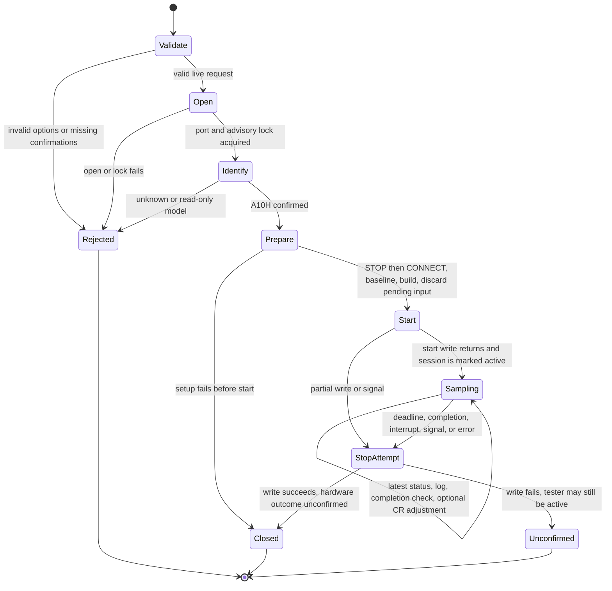
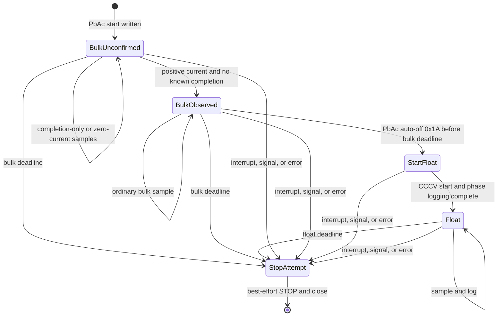
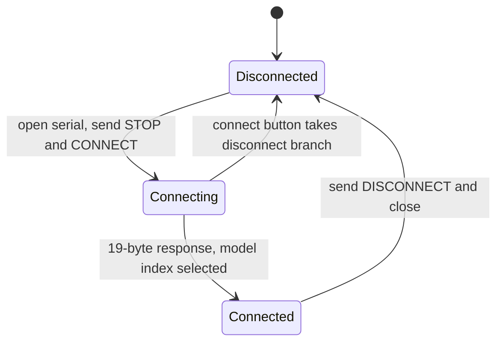
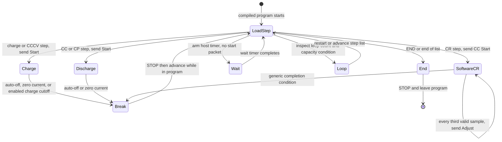

# State diagrams

These charts describe the inspected code, not a formally verified model of
the tester firmware. Serial writes have no start or STOP acknowledgement.
Retry details, logging internals, and GUI drawing states are omitted.

## CLI active-command lifecycle

`commands._run_profile` and `_run_mode` enter `SupervisedSession` before
starting. Named profiles return `EbcModeCommand` and use `device.begin_mode`,
the same start path as generic modes. `device._begin_frame` marks the device
active before the start write; device cleanup therefore also attempts STOP
after a partial write. Identification failure does not send STOP to an unknown
tester. Once the model is identified, preparation can send STOP even if later
packet validation fails. The separate `stop --execute` command skips
identification and the advisory lock.

Sampling deadlines bound status reads and sleeps. They do not preempt blocked
terminal output, filesystem I/O, or a hung host. SIGKILL and lost power do not
run these cleanup paths. Closing the file descriptor is not a hardware stop.

## Bulk-to-float

`session.run_bulk_to_float_session` requires observed bulk activity before
using `0x1A` as a transition. A stale auto-off alone cannot start float.
The deadline is checked again after output and logging, before the transition.
The float deadline starts after its startup callback completes. A float
startup error takes the cleanup path, not another charging phase.

## Controller connection

This is the normal path in `main.pas`, `btnConnectClick` and `SerialRec`.
The receive handler calls `InterpretPackage` before selecting model scaling.
The GUI's unknown model is a fallback copied from the first model entry.
The error handler displays a connection error; it does not explicitly reset
every connection field, so failure recovery is not drawn as a guaranteed
transition to Disconnected. `csCapture` is declared but is not used on this path.

## Controller step-program runner

The source runner lives in `main.pas`, `LoadStep` and `EBCBreak`.
Its parser lives in `stepform.pas`, `Compile`. This chart omits manual
Skip, manual stop, monitor-only use, and GUI settings changes. It is not a
claim that every documented step-language cutoff is active in the source.
The CLI does not implement this general program runner.
